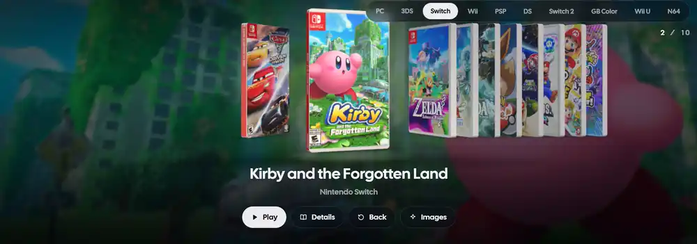
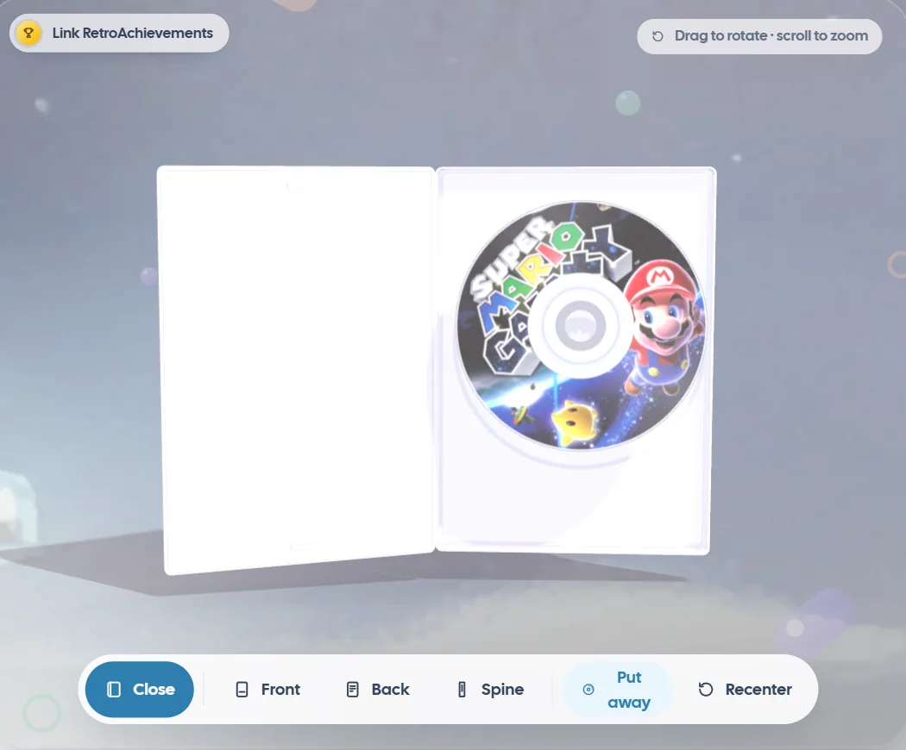
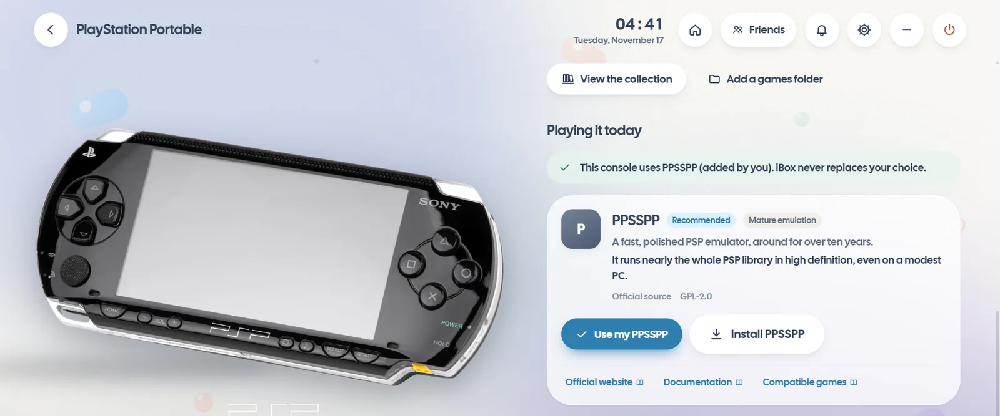
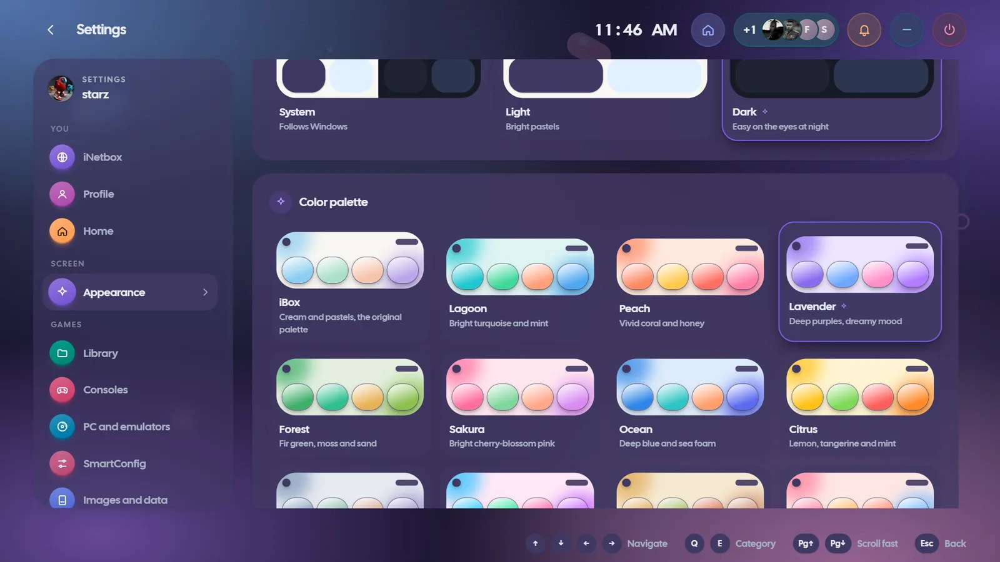
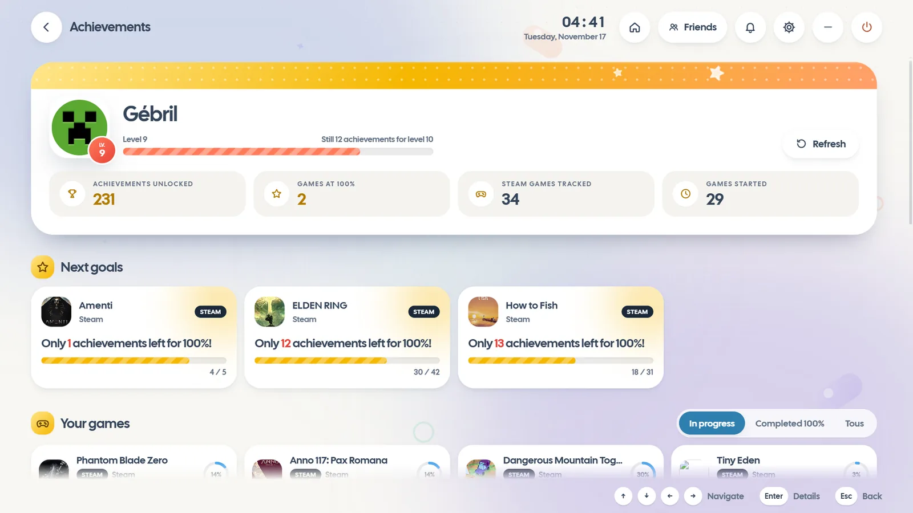
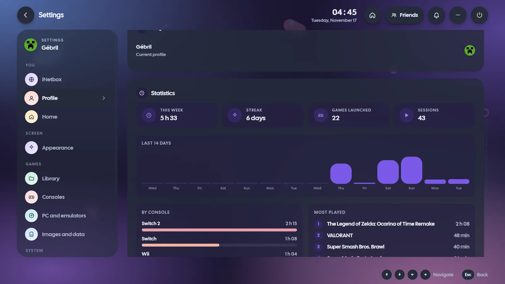

### Vos jeux retrouvent leur étagère.

iBox réunit vos jeux PC et votre collection console au même endroit et rend à chaque jeu son boîtier : une vraie boîte que l’on retourne, que l’on ouvre, et qui se lance.

<a href="https://github.com/atzski/ibox/releases/latest"><strong>Télécharger iBox pour Windows</strong></a>

Windows 10 et 11 (64 bits) · Gratuit et open source

<a href="README.md">English</a> · Français

 

## Une étagère pour tout ce que vous jouez

Vos jeux Steam, Epic et GOG se rangent juste à côté de vos disques Wii et de vos cartouches Game Boy. iBox les trouve, récupère leurs jaquettes et les aligne sur une étagère par console, comme dans votre salon. Choisissez-en un : tout l’écran prend ses couleurs.

  

- **Une seule bibliothèque** pour les jeux PC (Steam, Epic Games Store, GOG Galaxy ou n’importe quel `.exe`) et les jeux console de vos propres dossiers.
- **Des illustrations trouvées pour vous** sur SteamGridDB, GameTDB, LaunchBox, les vignettes libretro et iiDB : jaquettes, dos, tranches, vrais scans de disques, logos et fonds.
- **Collections et favoris** pour ranger vos jeux à votre façon, et les versions régionales d’un même jeu réunies sur une seule fiche.

## Des boîtiers que l’on prend en main

C’est le cœur d’iBox. Chaque jeu a son vrai boîtier en 3D, à la taille de sa console : boîtier GameCube et Wii, boîte fine de Switch, boîte en carton de Game Boy, boîtier DVD pour le PC. Retournez-le pour lire le dos, regardez la tranche, ouvrez-le et sortez le disque ou la cartouche.

  
  

À la souris (glisser, molette pour zoomer), au clavier ou au stick droit de la manette.

<h2></h2>

Un petit musée de 29 consoles, de l’Atari 2600 à la Switch 2, en vraies photographies sur une frise chronologique. Chaque console a sa page : son histoire, son matériel et vos jeux.

  

Quand une console a besoin d’un émulateur, sa page propose d’installer celui qui est recommandé. iBox le télécharge depuis sa source officielle, vérifie le fichier, l’installe dans votre dossier `iBox\Emulators` et l’associe à la console. Il signale aussi un BIOS ou un micrologiciel manquant et vous laisse importer votre propre fichier. Les émulateurs que vous utilisez déjà sont reconnus et jamais remplacés sans votre accord.

  

<h2></h2>

**En préparation.** SmartConfig examine le matériel de votre PC et règle chaque émulateur en conséquence, pour qu’un jeu tourne bien dès le premier lancement, sans fouiller dans les menus de réglages.

## Pensé pour le canapé

iBox se pilote depuis l’autre bout de la pièce. Chaque écran fonctionne à la manette, jusqu’à huit à la fois, et le mode TV agrandit l’interface et masque le curseur. Au bureau, clavier et souris fonctionnent tout aussi bien.

À votre goût : douze palettes de couleurs en mode clair ou sombre, un fond d’accueil choisi parmi vos jeux ou votre propre image, une musique de menu originale (ou la vôtre) et un petit jingle pour chaque jeu. Chacun à la maison a son profil, avec ses réglages, son thème et ses amis ; les jeux, eux, restent communs.

  
  

## Votre parcours

iBox garde la trace de vos parties : temps par jeu et par console, sessions, séries et les deux dernières semaines d’un coup d’œil. Les succès Steam et RetroAchievements se retrouvent dans une même salle des trophées, avec leur rareté, vos prochains objectifs et un classement entre amis. Un succès RetroAchievements débloqué s’affiche aussitôt, par-dessus le jeu.

  
  

  

## Jouer ensemble

Avec un compte **iNetbox** facultatif, ajoutez des amis, voyez à quoi ils jouent, discutez et invitez-les à une partie.

**Communauté :** en pleine partie, <kbd>Alt</kbd>+<kbd>E</kbd> garde une capture d’écran ou un clip des 12 dernières secondes, à partager avec vos amis, qui peuvent réagir, répondre et se mentionner.

<h2></h2>

**Expérimental, désactivé par défaut.** Recevez jusqu’à cinq amis dans votre partie, par internet et d’un PC à l’autre. Chaque invité joue avec sa propre manette, et vous décidez qui regarde, qui joue et qui peut utiliser le clavier et la souris. Détails dans [docs/REMOTE-PLAY.md](docs/REMOTE-PLAY.md).

## Plateformes prises en charge

- **Nintendo :** NES, Super NES, Nintendo 64, GameCube, Wii, Wii U, Switch, Switch 2, Game Boy, Game Boy Color, Game Boy Advance, DS, 3DS
- **Sony :** PlayStation, PlayStation 2, PlayStation 3, PSP
- **Microsoft :** Xbox, Xbox 360
- **Sega :** Master System, Mega Drive, Game Gear, Saturn, Dreamcast
- **Atari :** 2600, Jaguar
- **PC :** Steam, Epic Games Store, GOG Galaxy et jeux autonomes

iBox lance les jeux console avec l’émulateur de votre choix. Pour la plupart des consoles, il peut en installer un pour vous, notamment Dolphin, PCSX2, DuckStation, PPSSPP, RPCS3, Cemu, melonDS, Azahar, mGBA, Flycast et RetroArch.

## Bien démarrer

1. Téléchargez l’installateur `-setup.exe` depuis la [dernière version](https://github.com/atzski/ibox/releases/latest) et lancez-le.
2. Suivez l’assistant : choisissez vos dossiers de jeux et, si vous le souhaitez, connectez Steam et les services d’illustrations.
3. Ouvrez votre bibliothèque et choisissez un jeu.

Les clés d’API Steam, SteamGridDB, iiDB et RetroAchievements sont facultatives : elles ajoutent des fonctions, et le [guide d’utilisation](docs/GUIDE.md) (en anglais) explique comment obtenir chacune en quelques minutes. iBox se met à jour tout seul et propose chaque nouvelle version en un clic.

## Vos jeux, vos fichiers

iBox ne contient et ne télécharge ni jeux, ni BIOS, ni clés de micrologiciel. Utilisez des jeux que vous possédez et que vous avez copiés vous-même. Vos fichiers de jeux restent où ils sont ; votre bibliothèque, vos collections, vos réglages et vos profils sont enregistrés sur votre PC. Les services d’illustrations et iNetbox nécessitent une connexion internet.

iBox est un projet indépendant, sans lien avec Nintendo, Sony, Microsoft, Sega, Atari, Valve ou tout autre constructeur. Les jaquettes et marques visibles sur ces images appartiennent à leurs ayants droit.

## Aide et contributions

- **Un problème ?** [Ouvrez une issue](https://github.com/atzski/ibox/issues) avec votre version d’iBox et les étapes pour le reproduire. Retirez vos informations personnelles et vos clés d’API des captures et des journaux.
- **Compiler iBox ou lire le code ?** Voir le [guide de développement](docs/DEVELOPMENT.md) (en anglais).
- **Les notes de version** sont sur la [page des versions](https://github.com/atzski/ibox/releases) ; iBox les affiche aussi après chaque mise à jour.

iBox est distribué sous [licence MIT](LICENSE). La police Cal Sans est sous [SIL Open Font License](src/assets/fonts/cal-sans/OFL.txt), et les licences des autres composants inclus restent applicables.
