

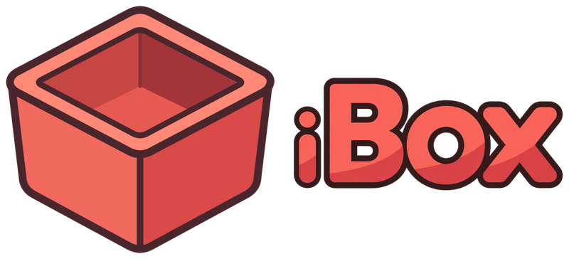

### Vos jeux retrouvent leur étagère.

iBox réunit vos jeux PC et votre collection console au même endroit et rend à chaque jeu son boîtier : une vraie boîte que l’on retourne, que l’on ouvre, et qui se lance.

<a href="https://github.com/atzski/ibox/releases/latest"><strong>Télécharger iBox pour Windows</strong></a>

Windows 10 et 11 (64 bits) · Gratuit et open source

<a href="README.md">English</a> · Français

 

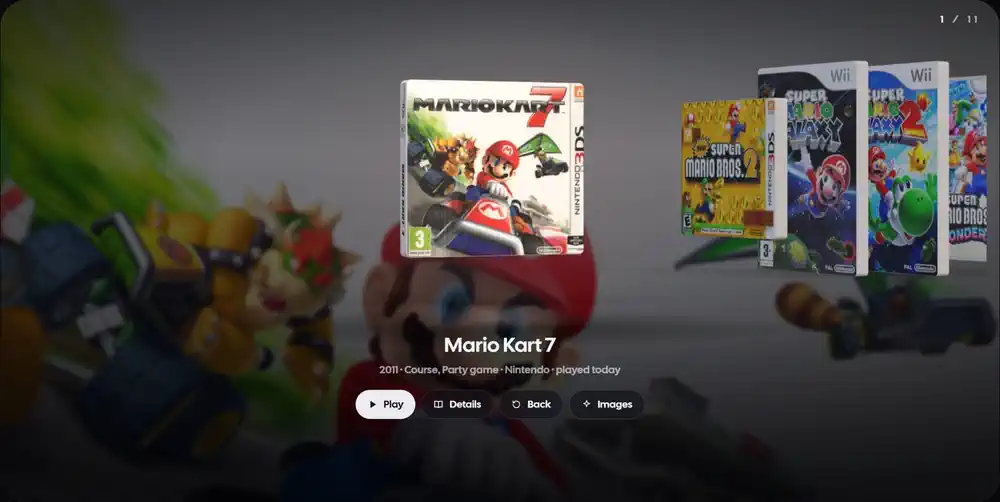

## Une étagère pour tout ce que vous jouez

Vos jeux Steam, Epic et GOG se rangent juste à côté de vos disques Wii et de vos cartouches 3DS. iBox les trouve, récupère leurs jaquettes et les aligne sur une étagère en 3D, comme dans votre salon. L’accueil montre toute votre collection d’un coup d’œil, met un de vos jeux à l’honneur à chaque retour et vous ramène à votre dernière aventure en un clic.

  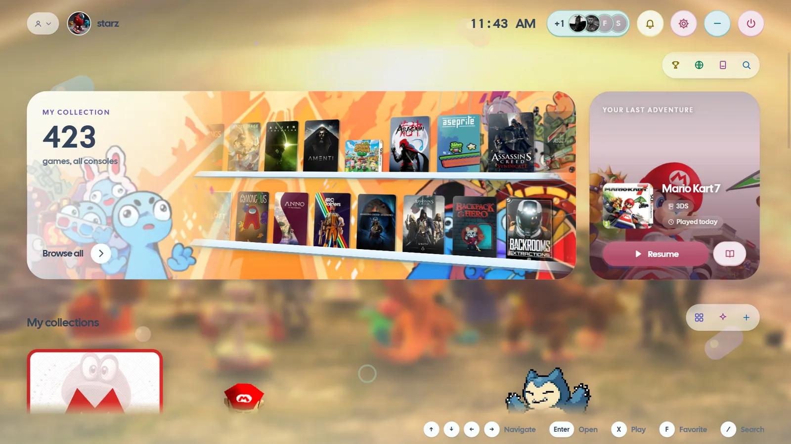

- **Une seule bibliothèque** pour les jeux PC (Steam, Epic Games Store, GOG Galaxy, EA, Ubisoft, Xbox, Riot ou n’importe quel `.exe`) et les jeux console de vos propres dossiers.
- **Des illustrations trouvées pour vous** sur SteamGridDB, GameTDB, LaunchBox, les vignettes libretro et iiDB : jaquettes, dos, tranches, vrais scans de disques, logos et fonds.
- **Les versions régionales** d’un même jeu réunies sur une seule fiche, et vos favoris à une touche.

## Des collections à votre image

Rangez vos jeux à votre façon, puis donnez à chaque collection son style. Une carte de collection peut montrer un éventail de boîtiers, une grande image, une mosaïque, ou seulement votre fond, votre logo et votre nom. Choisissez sa couleur, une icône de franchise iiDB, et posez-la où vous voulez sur l’accueil. Entre les cartes, ajoutez des décorations : logos transparents et icônes de personnages SteamGridDB, stickers animés GIPHY, Pokémon, ou votre propre image.

  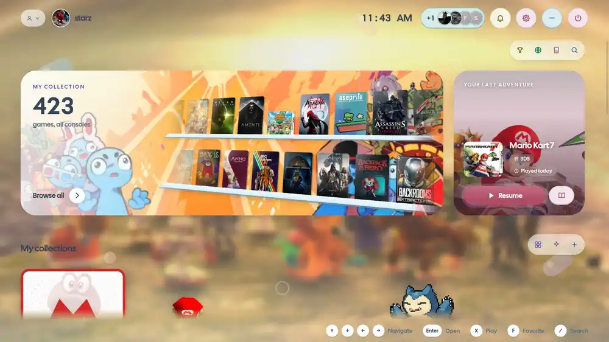
  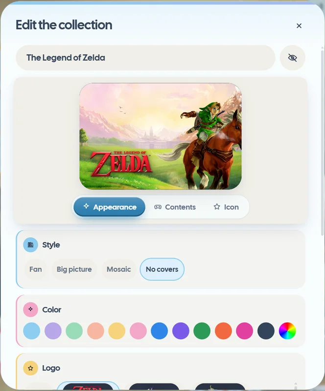

Ouvrez une collection : ses jeux défilent l’un après l’autre, chacun avec son décor. Remplissez-la à la main ou laissez-la se remplir seule : jeux jamais lancés, jeux multijoueur, un genre ou une console.

## Des boîtiers que l’on prend en main

C’est le cœur d’iBox. Chaque jeu a son vrai boîtier en 3D, à la taille de sa console : boîtier GameCube et Wii, boîte fine de Switch, boîte en carton de Game Boy, boîtier DVD pour le PC. Retournez-le pour lire le dos, regardez la tranche, ouvrez-le et sortez le disque ou la cartouche.

  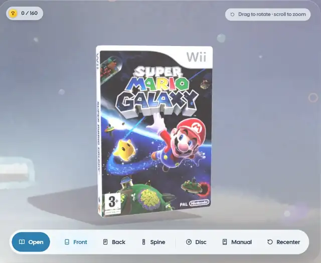
  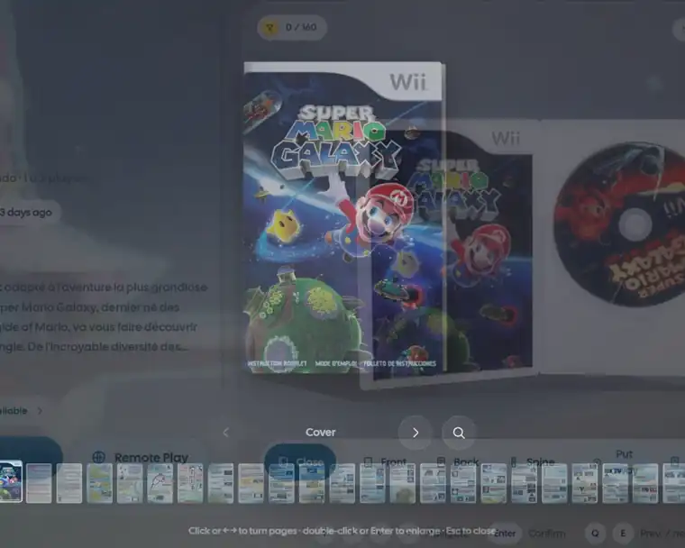

**Le manuel est dans la boîte.** Comme en vrai, chaque boîtier ouvert contient son livret. iBox cherche le manuel de chaque jeu en arrière-plan (Steam, ScreenScraper, Internet Archive) et ne le garde que s’il est sûr de l’édition ; vous pouvez aussi importer n’importe quel PDF, comme le scan de votre propre boîte. Cliquez sur le livret et feuilletez-le page après page, avec vignettes et zoom.

À la souris (glisser, molette pour zoomer), au clavier ou au stick droit de la manette.

<h2>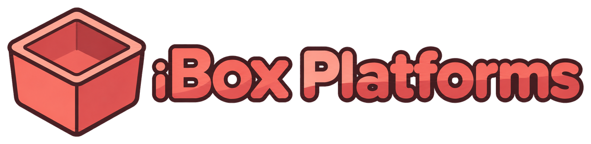</h2>

Un petit musée de 29 consoles, de l’Atari 2600 à la Switch 2, en vraies photographies sur une frise chronologique. Chaque console a sa page : son histoire, son matériel et vos jeux.

  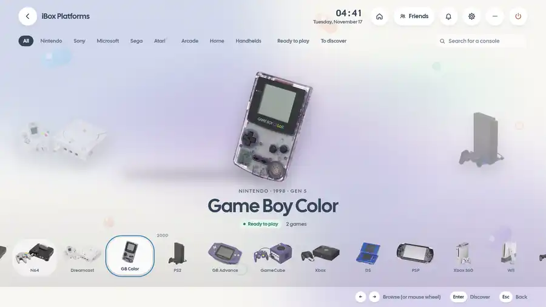

Quand une console a besoin d’un émulateur, sa page propose d’installer celui qui est recommandé. iBox le télécharge depuis sa source officielle, vérifie le fichier, l’installe dans votre dossier `iBox\Emulators` et l’associe à la console. Il signale aussi un BIOS ou un micrologiciel manquant et vous laisse importer votre propre fichier. Les émulateurs que vous utilisez déjà sont reconnus et jamais remplacés sans votre accord.

  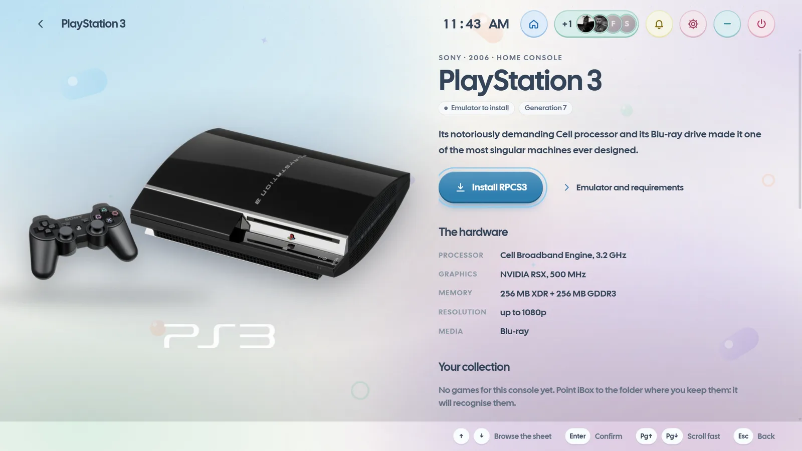

<h2></h2>

> **Disponible depuis la 0.1.74** pour Dolphin (GameCube, Wii), PCSX2, DuckStation, PPSSPP, RPCS3, Azahar et RetroArch (cœurs choisis). Les réglages sont vérifiés dans le code source de chaque émulateur, pas encore essayés dans chaque jeu.

Un émulateur compte des dizaines de réglages, et les bons dépendent du jeu *et* de votre PC : ce qui tourne en 4K sur une tour de joueur rame sur un portable. SmartConfig fait ce travail à votre place, jeu par jeu.

**Comment ça marche**

1. **Il fait connaissance avec votre PC.** Processeur, carte graphique, écran, et s’il s’agit d’un PC portable de jeu. Ces informations restent sur votre ordinateur.
2. **Il cherche des réglages qui ont fait leurs preuves.** Des configurations essayées par d’autres joueurs, classées selon la proximité de leur matériel avec le vôtre : même machine, machine proche ou conseil général.
3. **Vous choisissez un objectif.** *Performance* pour un jeu fluide, *Équilibré*, ou *Qualité* pour l’image la plus nette. *Manuel* ne touche à rien.
4. **Il applique les réglages à ce jeu seulement**, et vous revenez à votre configuration précédente en un clic.

  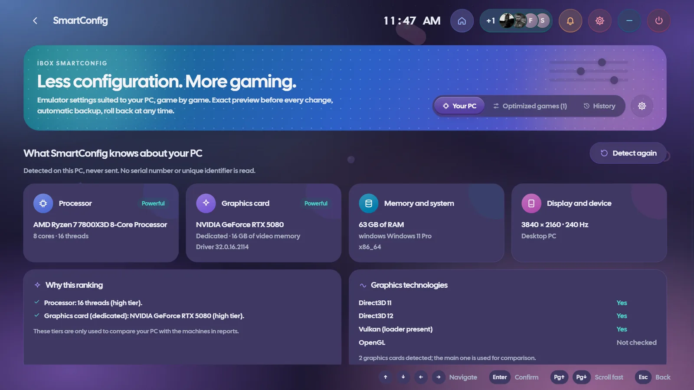

**Sûr par conception**

- Seuls des réglages connus d’iBox, avec des valeurs dans la plage permise, sont écrits. Rien de ce qui est téléchargé n’est recopié tel quel dans vos fichiers.
- Votre configuration précédente est sauvegardée avant chaque changement, et un réglage modifié à la main n’est jamais écrasé sans votre accord.
- Les correctifs livrés avec l’émulateur ne sont jamais contredits, et le reste de vos fichiers de configuration reste intact.

**D’où viennent les réglages**

- Les rapports publics de la communauté [EmuReady](https://www.emuready.com), consultés seulement quand vous ouvrez SmartConfig pour un jeu : seul le titre du jeu est envoyé.
- Envie de partager vos réglages ? Publiez-les sur [EmuReady](https://www.emuready.com) : iBox ne garde aucune configuration de joueur sur ses serveurs.
- Aucune télémétrie : votre matériel reste sur votre PC, et chaque source se désactive dans Paramètres › SmartConfig.

## Pensé pour le canapé

iBox se pilote depuis l’autre bout de la pièce. Chaque écran fonctionne à la manette, jusqu’à huit à la fois, et le mode TV agrandit l’interface et masque le curseur. Au bureau, clavier et souris fonctionnent tout aussi bien.

Start (ou F1) ouvre un menu rapide qui mène partout en deux appuis, et un clavier virtuel prend le relais quand il n’y a pas de clavier sous la main.

À votre goût : douze palettes de couleurs en mode clair ou sombre, un fond d’accueil choisi parmi vos jeux ou votre propre image, une musique de menu originale (ou la vôtre) et un petit jingle pour chaque jeu. Chacun à la maison a son profil, avec ses réglages, son thème et ses amis ; les jeux, eux, restent communs.

  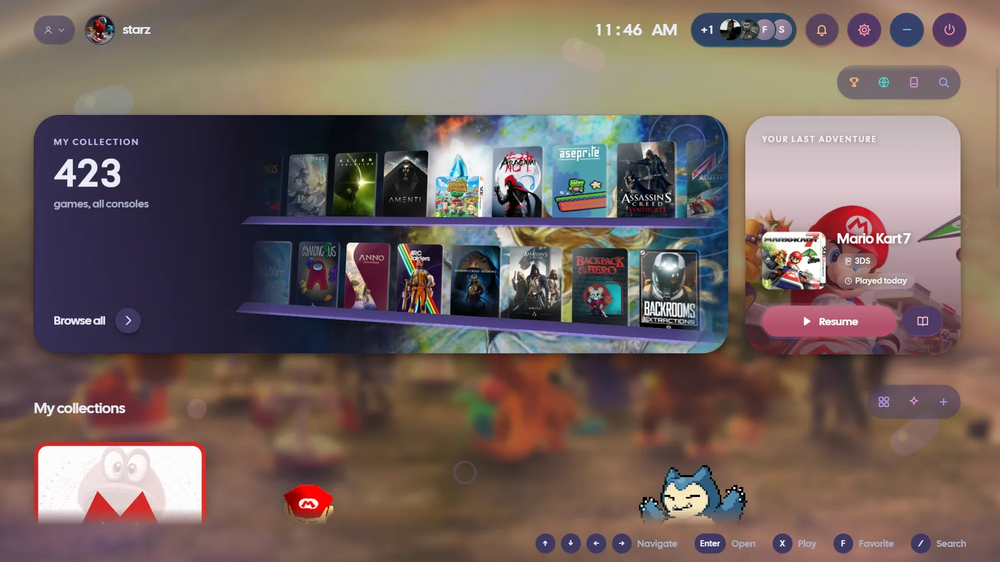
  

## Votre parcours

iBox garde la trace de vos parties : temps par jeu et par console, sessions, séries et les deux dernières semaines d’un coup d’œil. Les succès Steam et RetroAchievements se retrouvent dans une même salle des trophées, avec leur rareté, vos prochains objectifs et un classement entre amis. Un succès RetroAchievements débloqué s’affiche aussitôt, par-dessus le jeu.

  
  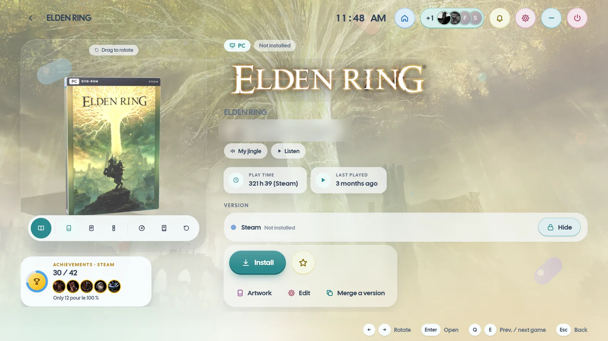

## Jouer ensemble

Avec un compte **iNetbox** facultatif, ajoutez des amis, voyez à quoi ils jouent, discutez et invitez-les à une partie.

**Communauté :** en pleine partie, <kbd>Alt</kbd>+<kbd>E</kbd> garde une capture d’écran ou un clip des 12 dernières secondes, à partager avec vos amis, qui peuvent réagir, répondre et se mentionner.

<h2></h2>

> **Expérimental**, désactivé par défaut : à activer dans *Paramètres › Remote Play*.

Jouez à un jeu multijoueur local avec des amis qui habitent loin. Le jeu tourne sur **votre** PC ; vos amis le voient en direct dans leur iBox et jouent avec leur propre manette, comme s’ils étaient assis dans votre canapé. Vous seul avez besoin de posséder et d’installer le jeu.

**Comment ça marche**

1. **Invitez.** Ouvrez le profil d’un ami et choisissez *Inviter à jouer*. Choisissez ce que vous partagez (tout l’écran ou seulement la fenêtre du jeu) et ce que votre ami a le droit de faire.
2. **Il accepte.** Votre ami reçoit une notification et vous rejoint en un clic.
3. **Jouez.** L’image et le son lui arrivent en temps réel, et sa manette apparaît sur votre PC comme un joueur de plus. Jusqu’à cinq amis peuvent rejoindre la même partie.

**Vous décidez qui fait quoi**

| Rôle | Ce qu’il peut faire |
|---|---|
| **Spectateur** | Regarder la partie, rien d’autre |
| **Joueur** | Jouer avec sa propre manette |
| **Collaborateur** | Utiliser aussi le clavier et la souris, après votre confirmation |

Quand vous ne partagez que la fenêtre du jeu, les invités peuvent utiliser des manettes, jamais votre clavier ni votre souris.

**Vous gardez la main**

- **Connexion directe.** L’image et les commandes vont d’un PC à l’autre. Le serveur iNetbox ne fait que vous présenter ; il ne voit jamais la partie.
- **Code de sécurité.** Le même code s’affiche sur les deux écrans : vous vérifiez que vous êtes bien connecté à votre ami.
- **Arrêt d’urgence.** <kbd>Ctrl</kbd>+<kbd>Alt</kbd>+<kbd>Maj</kbd>+<kbd>F12</kbd> coupe tout d’un coup, et un indicateur reste visible tant que quelqu’un est connecté. Verrouiller Windows met aussi fin à la session.
- **Aucune surprise.** Vous ne recevez d’invitations que si vous l’avez autorisé, et quand un réseau bloque la connexion directe, iBox vous explique pourquoi au lieu d’échouer en silence.

Les détails techniques sont dans [docs/REMOTE-PLAY.md](docs/REMOTE-PLAY.md).

## Plateformes prises en charge

- **Nintendo :** NES, Super NES, Nintendo 64, GameCube, Wii, Wii U, Switch, Switch 2, Game Boy, Game Boy Color, Game Boy Advance, DS, 3DS
- **Sony :** PlayStation, PlayStation 2, PlayStation 3, PSP
- **Microsoft :** Xbox, Xbox 360
- **Sega :** Master System, Mega Drive, Game Gear, Saturn, Dreamcast
- **Atari :** 2600, Jaguar
- **PC :** Steam, Epic Games Store, GOG Galaxy et jeux autonomes

iBox lance les jeux console avec l’émulateur de votre choix. Pour la plupart des consoles, il peut en installer un pour vous, notamment Dolphin, PCSX2, DuckStation, PPSSPP, RPCS3, Cemu, melonDS, Azahar, mGBA, Flycast et RetroArch.

## Bien démarrer

1. Téléchargez l’installateur `-setup.exe` depuis la [dernière version](https://github.com/atzski/ibox/releases/latest) et lancez-le.
2. Suivez l’assistant : choisissez vos dossiers de jeux et, si vous le souhaitez, connectez Steam et les services d’illustrations.
3. Ouvrez votre bibliothèque et choisissez un jeu.

Les clés d’API Steam, SteamGridDB, iiDB et RetroAchievements sont facultatives : elles ajoutent des fonctions, et le [guide d’utilisation](docs/GUIDE.md) (en anglais) explique comment obtenir chacune en quelques minutes. iBox se met à jour tout seul et propose chaque nouvelle version en un clic.

## Vos jeux, vos fichiers

iBox ne contient et ne télécharge ni jeux, ni BIOS, ni clés de micrologiciel. Utilisez des jeux que vous possédez et que vous avez copiés vous-même. Vos fichiers de jeux restent où ils sont ; votre bibliothèque, vos collections, vos réglages et vos profils sont enregistrés sur votre PC. Les services d’illustrations et iNetbox nécessitent une connexion internet.

iBox est un projet indépendant, sans lien avec Nintendo, Sony, Microsoft, Sega, Atari, Valve ou tout autre constructeur. Les jaquettes et marques visibles sur ces images appartiennent à leurs ayants droit.

## Aide et contributions

- **Un problème ?** [Ouvrez une issue](https://github.com/atzski/ibox/issues) avec votre version d’iBox et les étapes pour le reproduire. Retirez vos informations personnelles et vos clés d’API des captures et des journaux.
- **Compiler iBox ou lire le code ?** Voir le [guide de développement](docs/DEVELOPMENT.md) (en anglais).
- **Les notes de version** sont sur la [page des versions](https://github.com/atzski/ibox/releases) ; iBox les affiche aussi après chaque mise à jour.

iBox est distribué sous [licence MIT](LICENSE). La police Cal Sans est sous [SIL Open Font License](src/assets/fonts/cal-sans/OFL.txt), et les licences des autres composants inclus restent applicables.
