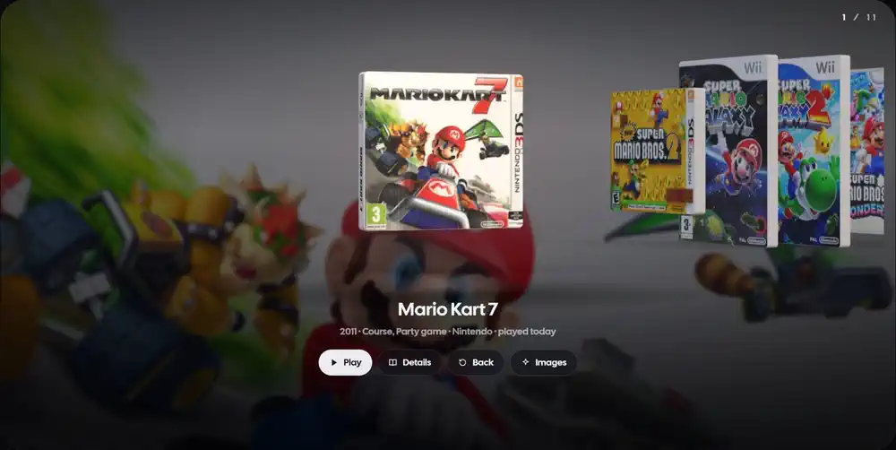
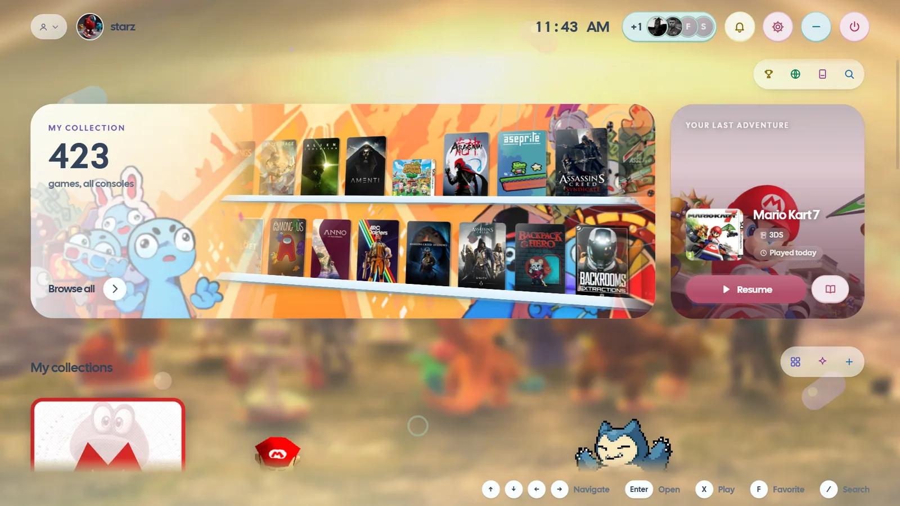
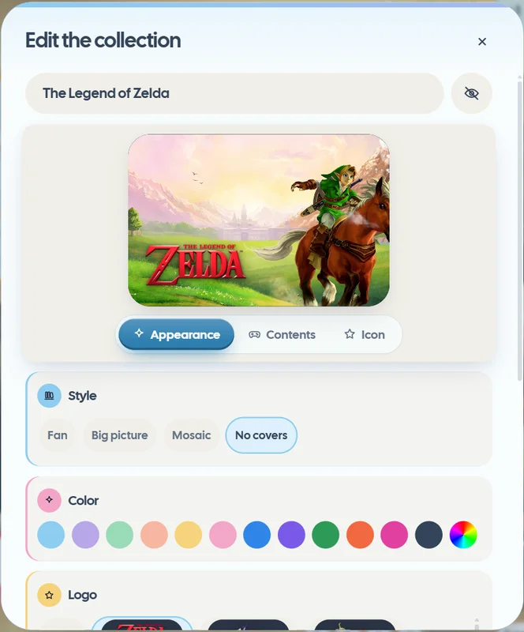
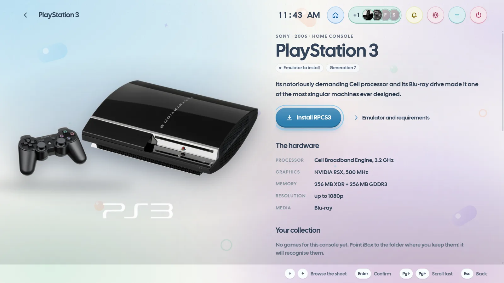
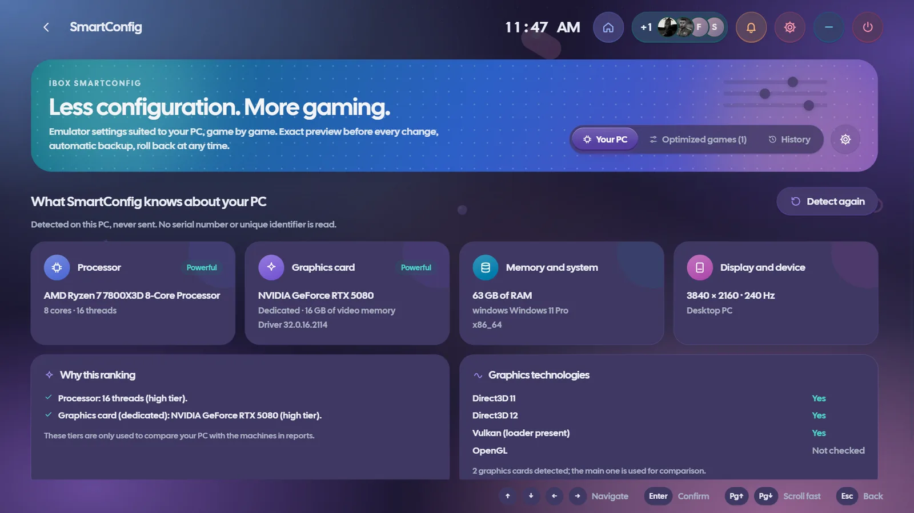
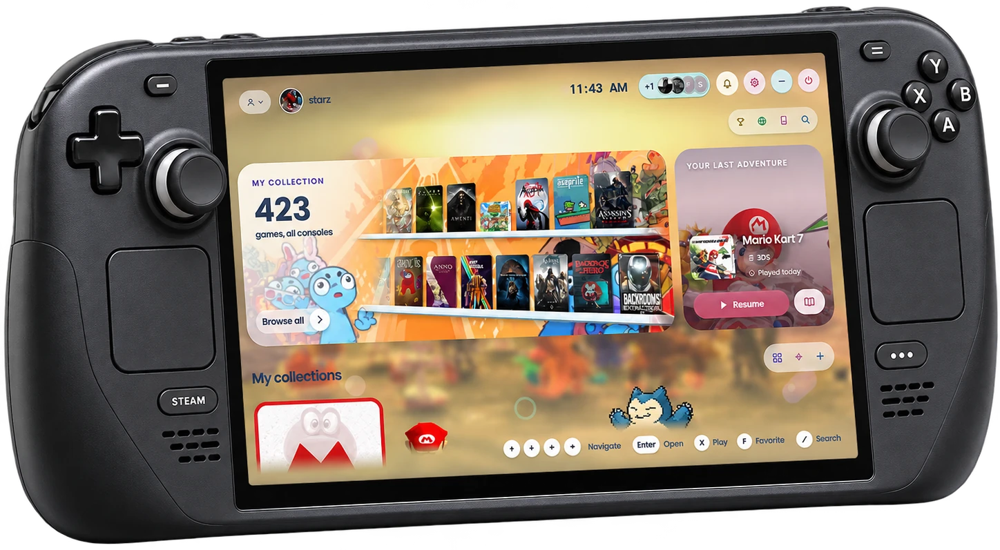

### Your games, back on the shelf.

iBox gathers your PC games and your console collection in one place and gives every game its case again: a real box you can turn over, open and play.

<a href="https://github.com/atzski/ibox/releases/latest"><strong>Download iBox for Windows</strong></a>

Windows 10 and 11 (64-bit) · Free and open source

Also on <a href="#also-on-steam-deck"><strong>Steam Deck</strong></a> (preview)

Join the community on <a href="https://discord.gg/xg6uQbYGZK"><strong>Discord</strong></a>

English · <a href="README.fr.md">Français</a>

 

## A shelf for everything you play

Your Steam, Epic and GOG games sit right next to your Wii discs and 3DS cartridges. iBox finds them, fetches their covers, and lines them up on a 3D shelf, the way they would sit in your living room. The home screen shows your whole collection at a glance, puts one of your games in the spotlight each time you come back, and gets you back into your last adventure in one click.

  

- **One library** for PC games (Steam, Epic Games Store, GOG Galaxy, EA, Ubisoft, Xbox, Riot, or any `.exe`) and console games from your own folders.
- **Artwork found for you** from SteamGridDB, GameTDB, LaunchBox, the libretro thumbnails and iiDB: covers, backs, spines, real disc scans, logos and backgrounds.
- **Regional versions** of the same game merged into a single entry, and favourites one key away.

## Collections that look like yours

Group games your way, then make each collection your own. A collection card can show a fan of cases, one big picture, a mosaic, or just your background, logo and name. Give it a colour, a franchise icon from iiDB, and drop it wherever you like on the home screen. Between the cards, add decorations: transparent game logos and character icons from SteamGridDB, animated stickers from GIPHY, Pokémon sprites, or your own image.

  
  

Open a collection and its games come one after another, each with its own backdrop. Fill it by hand or let it fill itself: games never launched, multiplayer games, a genre or a console.

## Cases you can hold

This is the part we care about most. Every game has a proper case in 3D, sized for its console: a keep case for GameCube and Wii, a slim case for Switch, a cardboard box for Game Boy, a DVD case for PC. Turn it around to read the back, look at the spine, open it, and take out the disc or the cartridge.

  
  

**The manual is in the box.** Like the real thing, every open case holds its booklet. iBox looks for each game's manual in the background (Steam, ScreenScraper, the Internet Archive) and only keeps it when it is sure of the edition; you can also import any PDF, such as a scan of your own box. Click the booklet and read it page by page, with thumbnails and zoom.

Works with a mouse (drag, scroll to zoom), the keyboard or a controller's right stick.

<h2></h2>

A small museum of 29 consoles, from the Atari 2600 to the Switch 2, photographed and laid out on a timeline. Each console has its own page with its history, its hardware and your games for it.

  

When a console needs an emulator, its page offers to install the recommended one. iBox downloads it from the official source, checks the file, installs it in your `iBox\Emulators` folder and links it to the console. It also tells you when a BIOS or firmware is missing and lets you import your own file. Emulators you already use are detected and never replaced without asking.

  

<h2></h2>

> **Available since 0.1.74** for Dolphin (GameCube, Wii), PCSX2, DuckStation, PPSSPP, RPCS3, Azahar and RetroArch (selected cores). Settings have been checked against each emulator's source code, not yet tested in every game.

Emulators have dozens of settings, and the right ones depend on the game *and* on your PC: what runs at 4K on a gaming tower stutters on a laptop. SmartConfig does the homework for you, one game at a time.

**How it works**

1. **It gets to know your PC.** Processor, graphics card, screen, and whether you are on a handheld PC. This stays on your computer.
2. **It looks for settings that worked.** Configurations tested by other players, ranked by how close their hardware is to yours: same machine, similar machine, or general advice.
3. **You pick a goal.** *Performance* for a smooth game, *Balanced*, or *Quality* for the sharpest picture. *Manual* leaves everything as it is.
4. **It applies the settings to that game only**, and you can go back to your previous setup in one click.

  

**Safe by design**

- Only settings iBox knows, with values in the allowed range, are ever written. Nothing downloaded is copied into your files as is.
- Your previous configuration is saved before every change, and a setting you changed by hand is never overwritten without asking.
- Fixes that ship with the emulator are never contradicted, and the rest of your configuration files stays untouched.

**Where the settings come from**

- Public reports from the [EmuReady](https://www.emuready.com) community, fetched only when you open SmartConfig for a game: only the game's title is sent.
- Want to share your own settings? Post them on [EmuReady](https://www.emuready.com): iBox keeps no player configurations on its servers.
- No telemetry: your hardware stays on your PC, and every source can be turned off in Settings › SmartConfig.

## Made for the sofa

iBox is designed to be used from across the room. Every screen works with a controller, up to eight of them, and a TV mode makes the interface bigger and hides the cursor. Keyboard and mouse work just as well at a desk.

Press Start (or F1) for a quick menu that takes you anywhere in two presses, and type with an on-screen keyboard when there is no keyboard around.

Make it yours: twelve colour palettes in light or dark mode, a home background picked from your games or your own image, an original menu soundtrack (or your own music), and a short jingle for each game. Everyone in the house gets their own profile, with their own settings, theme and friends; the games stay shared.

  
  

## Also on Steam Deck

The same library, in your hands. A Linux version of iBox made for the Steam Deck's Game Mode is released alongside the Windows version, which stays the main one. It is a preview: it works, and your feedback will shape it.

  

- **Game Mode**: one full-screen window, the Deck's controls, and iBox in your Steam library with its own artwork.
- **Your games**: Steam, Epic, GOG and Amazon games installed with Heroic, and your Lutris games.
- **Every emulator in one click**, just like on Windows, from its official release or from Flathub; SmartConfig tunes each game for the Deck.
- **Remote Play**: join a friend's game running on a Windows PC with iBox, with the Deck's controls, trackpads and keyboard.
- **Built for the battery**: a Steam Deck graphics profile, a power-saving one on battery, and everything picks up again after sleep.

Hosting a Remote Play game, the in-game overlay and stores without a Linux version stay on Windows. Licences of the components bundled with the Linux version are listed in [THIRD-PARTY-LINUX.md](docs/THIRD-PARTY-LINUX.md).

## Your journey

iBox keeps track of what you play: time per game and per console, sessions, streaks and the last two weeks at a glance. Steam achievements and RetroAchievements meet in one trophy room, with rarity, next goals and a leaderboard with your friends. A RetroAchievements unlock shows up right away, over the game.

  
  

## Play together

With an optional **iNetbox** account you can add friends, see what they are playing, chat, and invite them to a game.

**Community:** press <kbd>Alt</kbd>+<kbd>E</kbd> during a game to save a screenshot or a clip of the last 12 seconds, then share it with friends, who can react, reply and mention each other.

<h2></h2>

> **Experimental**, off by default: turn it on in *Settings › Remote Play*.

Play a local multiplayer game with friends who live far away. The game runs on **your** PC; your friends see it live in their own iBox and play with their own controller, as if they were sitting on your sofa. Only you need to own and install the game.

**How it works**

1. **Invite.** Open a friend's profile and choose *Invite to play*. Pick what you share (your whole screen or just the game window) and what your friend is allowed to do.
2. **Accept.** Your friend gets a notification and joins with one click.
3. **Play.** The picture and sound reach them in real time, and their controller shows up on your PC as an extra player. Up to five friends can join the same game.

**You choose who does what**

| Role | What they can do |
|---|---|
| **Spectator** | Watch the game, nothing else |
| **Player** | Play with their own controller |
| **Collaborator** | Also use the keyboard and mouse, after you confirm it |

When you share only the game window, guests can use controllers but never your keyboard and mouse.

**You stay in control**

- **Direct connection.** Picture and controls go straight from PC to PC. The iNetbox server only introduces you to each other; it never sees the game.
- **Security code.** Both screens show the same code, so you can check you are really connected to your friend.
- **Emergency stop.** <kbd>Ctrl</kbd>+<kbd>Alt</kbd>+<kbd>Shift</kbd>+<kbd>F12</kbd> cuts everything at once, and a visible indicator stays on while someone is connected. Locking Windows also ends the session.
- **Nothing by surprise.** You only receive invitations if you allowed it, and when a network blocks a direct connection, iBox tells you why instead of failing silently.

The technical details are in [docs/REMOTE-PLAY.md](docs/REMOTE-PLAY.md) (in French).

## Supported platforms

- **Nintendo:** NES, Super NES, Nintendo 64, GameCube, Wii, Wii U, Switch, Switch 2, Game Boy, Game Boy Color, Game Boy Advance, DS, 3DS
- **Sony:** PlayStation, PlayStation 2, PlayStation 3, PSP
- **Microsoft:** Xbox, Xbox 360
- **Sega:** Master System, Mega Drive, Game Gear, Saturn, Dreamcast
- **Atari:** 2600, Jaguar
- **PC:** Steam, Epic Games Store, GOG Galaxy and standalone games

iBox launches console games through the emulator of your choice. For most consoles it can install one for you, including Dolphin, PCSX2, DuckStation, PPSSPP, RPCS3, Cemu, melonDS, Azahar, mGBA, Flycast and RetroArch.

## Getting started

1. Download the `-setup.exe` installer from the [latest release](https://github.com/atzski/ibox/releases/latest) and run it.
2. Follow the setup wizard: choose your game folders and, if you like, connect Steam and the artwork services.
3. Open your library and pick a game.

**On Steam Deck:** in Desktop Mode, download the `.AppImage` from the [latest release](https://github.com/atzski/ibox/releases/latest), make it executable (right-click › Properties › Permissions), open it, then quit Steam and use Settings › System › **Add iBox to Steam**. In Game Mode, iBox is waiting in your library.

API keys for Steam, SteamGridDB, iiDB and RetroAchievements are optional: they add features, and the [user guide](docs/GUIDE.md) shows how to get each one in a couple of minutes. iBox updates itself and offers new versions with one click.

## Your games, your files

iBox does not include or download games, BIOS files or firmware keys. Use games you own and dump them yourself. Your game files stay where they are; your library, collections, settings and profiles are stored on your PC. Artwork services and iNetbox need an internet connection.

iBox is an independent project, not affiliated with Nintendo, Sony, Microsoft, Sega, Atari, Valve or any other platform owner. Game covers and trademarks shown in these images belong to their respective owners.

## Help and contributing

- **Something wrong?** [Open an issue](https://github.com/atzski/ibox/issues) with your iBox version and the steps to reproduce it. Please remove personal information and API keys from screenshots and logs.
- **Building iBox or reading the code?** See the [development guide](docs/DEVELOPMENT.md).
- **Release notes** are on the [Releases page](https://github.com/atzski/ibox/releases); iBox also shows them after each update.

iBox is released under the [MIT licence](LICENSE). The Cal Sans font is under the [SIL Open Font License](src/assets/fonts/cal-sans/OFL.txt), and the licences of other included components still apply.
