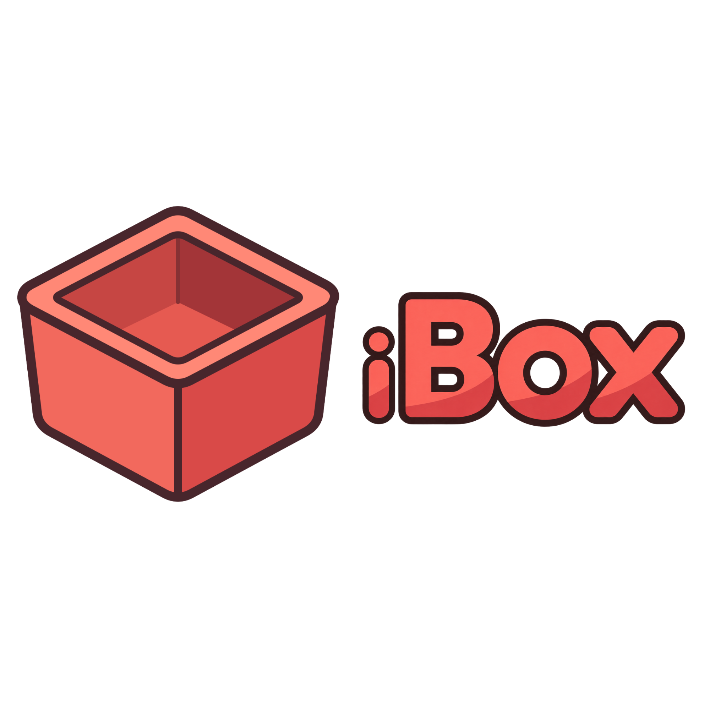
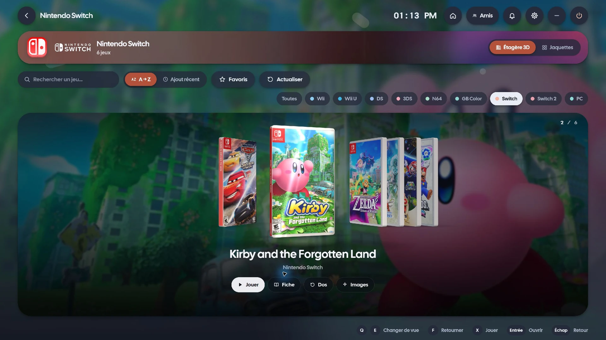

  
  
<strong>Your games, together.</strong>

  
A personal game library for Windows, built for exploring and playing.

  
<a href="https://github.com/atzski/ibox/releases/latest"><strong>Download iBox for Windows</strong></a> · Windows 10 and 11 · 64-bit

## About iBox

iBox brings your PC games and console collection together in one place. Browse a 3D shelf, turn game cases around to see their artwork, and launch your next adventure from a single library.

## Features

- **One library:** bring together PC games and your own console game folders.
- **3D game cases:** explore cover artwork and game details.
- **Personal collections:** choose artwork and colours, and arrange your games your way.
- **Controller support:** navigate with a controller, keyboard or mouse.
- **iNetbox:** optionally add friends, share your status and send game invitations.
- **Remote Play (experimental):** play together over the internet, up to 6 players, each with their own controller.
- **Community:** share screenshots and clips, react, reply and mention friends with @.
- **Your activity:** revisit recently played games and track playtime.

> **New to iBox?** Follow the [step-by-step setup and API keys guide](docs/GUIDE.md).

## Download and setup

1. Download the installer from the [latest release](https://github.com/atzski/ibox/releases/latest).
2. Install iBox and follow the setup guide to add your game folders and configure your sources and emulators.
3. Open your library and choose a game.

Existing users can check for updates under **Settings → System → Updates**. iBox also checks for new versions on its own and offers a one-click install.

## Remote Play (experimental)

Play with your iNetbox friends from anywhere, directly from PC to PC. The host shares their screen or a game window; friends see it, hear it and play with their own controller, as if they were in the same room.

- **Up to 6 players:** the host plus 5 guests, each with their own direct connection and controller. Guest controllers appear on the host as extra Xbox controllers (through the ViGEmBus driver, installed in one click).
- **Picture and sound:** Windows Graphics Capture, hardware H.264 encoding (NVIDIA NVENC, AMD AMF, Intel Quick Sync, including PCs with two graphics cards; software as a last resort) and 48 kHz Opus audio, sent peer to peer over WebRTC (UDP) with no relay server.
- **The host decides:** every guest starts with no rights. *Spectator* (watch and listen), *Player* (+ controller), *Collaborator* (+ keyboard and mouse, after confirmation). On a game window, keyboard and mouse stay confined to that window and system shortcuts (Windows key, Alt+Tab, Alt+F4…) are refused.
- **Security:** iNetbox only introduces the two PCs (offers signed with a per-device key, DTLS fingerprints checked, a safety code to compare out loud); it never sees the picture or the inputs. A banner stays visible during any share, an emergency shortcut cuts everything, and sharing stops as soon as Windows locks.
- **Turning it on:** off by default; use the *Remote Play* button on a game page, or **Settings → Remote Play**. Technical details: [docs/REMOTE-PLAY.md](docs/REMOTE-PLAY.md) (in French).

## Games and privacy

iBox does not include games, BIOS files or emulators. Use your own legally obtained games and the software needed to run them. iBox is independent and is not affiliated with the owners of the platforms or brands it supports.

Your library, collections, settings and local profile are stored on your PC; your game files stay in their original folders. Online artwork services and the optional iNetbox account require an internet connection.

## A closer look

Game artwork and trademarks shown in screenshots belong to their respective owners.

## Support and development

Found a problem? [Open an issue](https://github.com/atzski/ibox/issues) with your iBox version and steps to reproduce it. Check screenshots and logs for private information before sharing them.

Looking for build instructions, controls or technical documentation? See the [development guide](docs/DEVELOPMENT.md). iBox code is available under the [MIT license](LICENSE); third-party licenses remain applicable.
