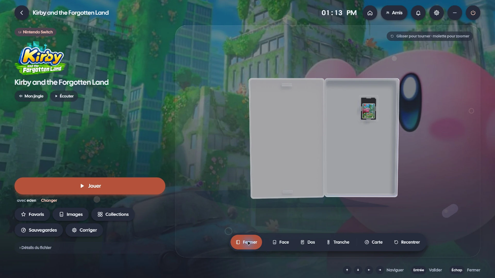

# iBox

Bibliothèque de jeux et frontend d'émulation immersif pour Windows (Tauri 2 · React · Three.js).
[Télécharger iBox pour Windows](https://github.com/atzski/inbox-releases/releases/latest).

## Aperçu

**Étagère 3D Nintendo Switch**


**Fiche du jeu et boîtier ouvert**



Les marques et illustrations de jeux visibles dans ces captures appartiennent à leurs ayants droit.

## Développement

Node.js 24, Rust stable (MSVC), Visual Studio Build Tools avec C++ et WebView2 sont requis.

Ce dépôt contient l'application Windows, ses modèles 3D et le code client iNetbox. Les builds GitHub Actions produisent un installateur Windows de test et son SHA-256 à partir du commit. Les versions distribuées aux utilisateurs sont disponibles dans le dépôt des téléchargements.

La compilation publique permet d'importer sa propre musique d'ambiance dans Paramètres → Son. La piste locale des versions historiques et les médias récupérés auprès des fournisseurs de jaquettes ne sont pas inclus.

## Commandes

```bash
npm ci
npm run tauri dev      # application Windows avec rechargement à chaud
npm run dev            # aperçu dans le navigateur (http://localhost:1420)
npm test               # tests unitaires (interface)
cd src-tauri && cargo test   # tests Rust (scanner, base, métadonnées)
cd src-tauri && cargo test --test live_sources -- --ignored --nocapture   # tests réseau réels
npm run build          # vérification des types + build du front
npm run tauri build -- --bundles nsis --config src-tauri/tauri.ci.conf.json
```

## Commandes de l'interface

| Action | Clavier | Manette | Souris |
| --- | --- | --- | --- |
| Naviguer | Flèches | Croix / stick gauche | Survol / clic |
| Valider | Entrée | A (Nintendo : droite, Xbox/PS : bas) | Clic |
| Retour | Échap / Retour arrière | B | Bouton « précédent » / flèche en haut à gauche |
| Changer de vue (bibliothèque) | Q / E | L / R | Interrupteur Jaquettes / Étagère 3D |
| Pivoter le boîtier | ← → (visionneuse focalisée) | Stick droit | Glisser |
| Ouvrir / fermer | Entrée (visionneuse) | A | Double-clic ou bouton Ouvrir |
| Zoom | + / − | Gâchettes | Molette |

## Documentation

- [Architecture et design system](docs/ARCHITECTURE.md)
- [Phase 2 — bibliothèque réelle](docs/PHASE2.md)
- [Phase 3 — métadonnées et jaquettes](docs/PHASE3.md)
- [Phase 4 — émulateurs](docs/PHASE4.md)
- [Phase 5 — boîtiers par console, manette](docs/PHASE5.md)
- [Sources et licences](docs/PROVIDERS.md)
- [Profils de lancement des émulateurs](docs/EMULATORS.md)

### Données et restauration

L’exécutable autonome `ibox.exe` et l’installateur NSIS utilisent le même dossier de données Windows, `%APPDATA%\app.ibox.desktop`. WebView2 est requis. Les fichiers de jeux restent dans leurs dossiers d’origine.

Dans **Paramètres → Bibliothèque → Sauvegardes de la bibliothèque**, choisissez une sauvegarde par date et nombre de jeux. iBox se ferme après confirmation. Au prochain lancement, la base précédente est archivée dans un dossier `before-restore-*`. Les sauvegardes concernent SQLite. Les fichiers de jeux et les images en cache restent sur le disque.

## Profile Studio

Ouvrir **Paramètres → Profil → Personnaliser** pour éditer le profil local et voir l’aperçu avant enregistrement. Les avatars existants restent compatibles. Les photos et bannières importées restent sur cet ordinateur. Les références Riot sont enregistrées sans copier les images distantes dans le dépôt.

**Riot Data Dragon** se règle dans **Sources d’avatars**. Le catalogue est paginé et les images viennent du CDN. Avant distribution publique, enregistrer iBox et soumettre la fonctionnalité à l’audit Riot. [Politiques Riot](https://developer.riotgames.com/policies/general)

## Licence

Le code iBox est distribué sous licence [MIT](LICENSE). La police Cal Sans est sous [SIL Open Font License](src/assets/fonts/cal-sans/OFL.txt). Les avis de licence présents dans le dépôt restent applicables aux composants concernés.
